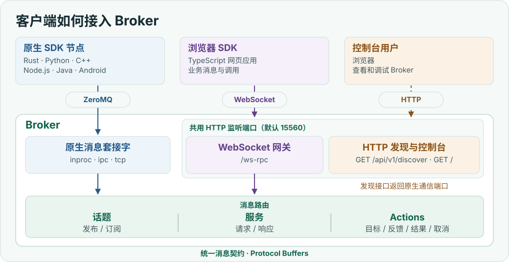
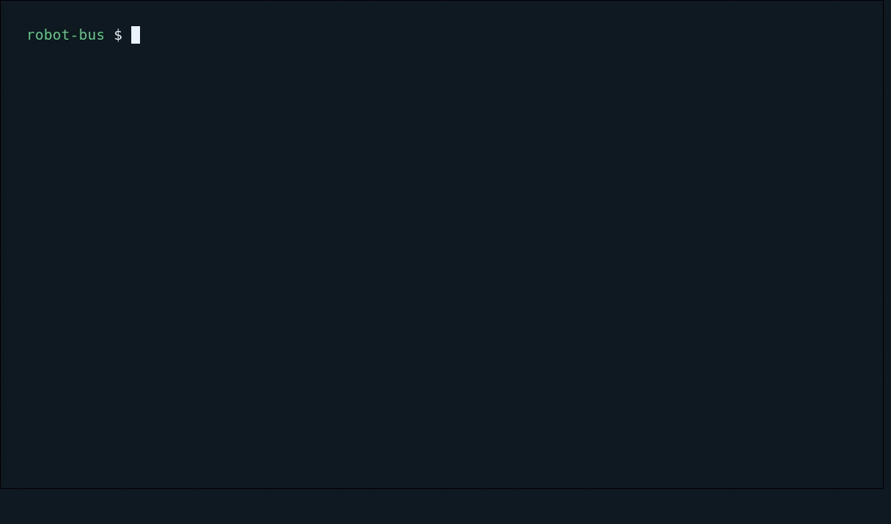
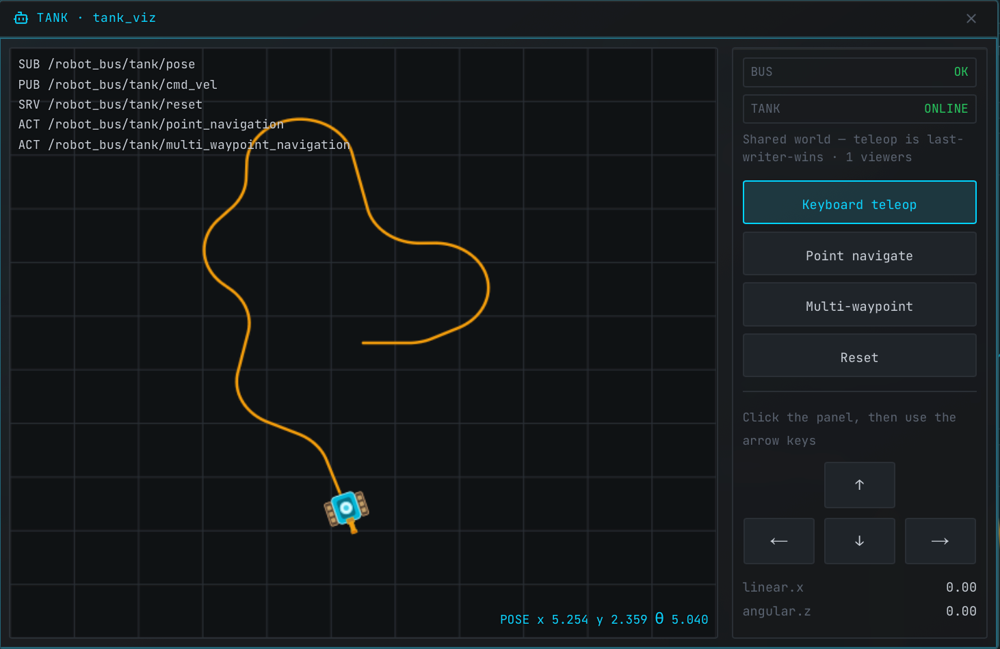

[English](README.md) | 中文

# *Robot Bus*

[](https://github.com/indunet/robot-bus/actions/workflows/ci.yml)
[](https://crates.io/crates/robot-bus)
[](https://pypi.org/project/robot-bus/)
[](https://www.npmjs.com/package/robot-bus)
[](https://central.sonatype.com/artifact/org.indunet/robot-bus)
[](https://www.apache.org/licenses/LICENSE-2.0.html)

Robot Bus 是面向机器人应用的轻量级多语言通信框架。不同语言编写的组件可以通过同一个 broker 发布状态、调用服务、下发或取消长时间运行的任务。核心通信基于 ZeroMQ，可以独立运行，不需要安装 ROS 2 或打开浏览器。

例如，[Rust 进程发布 IMU 数据，Python 进程接收](examples/README.md#1-topic-topic_imu)：两端通过 TCP 连接到同一个 broker，共用同一种 Protobuf 消息类型。

[运行 Python 快速开始](#1-快速开始) · [按任务找文档](#16-文档)

SDK：**Rust**、**Python**、**TypeScript**、**C++**、**Java**、**Android**。

## *核心功能*

- **ROS 2 风格的编程模型：** 用 `Node` 和 `spin` 驱动节点；Topic 用于发布订阅，Service 用于请求应答，Action 支持目标、反馈、结果和取消。节点还支持定时器和参数。
- **一个 broker，多种语言：** Rust、Python、TypeScript、C++、Java、Android SDK接入同一条总线。**更鼓励在程序里启动 broker**（`RobotBusBroker.start()`）；CLI 用于演示或独立进程。
- **Protobuf契约：** 全部载荷使用 Protocol Buffers（不是 ROS CDR），目录与常见 ROS2包名对齐，见 [`proto/`](proto/)。

Node编程模型——`Context` / `Node`、topic pub-sub、service、action以及 `spin`——为稳定的公开 API。

需要精简构建？参见[按需构建](docs/zh/build-profiles.md)，可选择原生 ZMQ SDK、WebSocket 通信、监控 API、内嵌控制台和坦克演示。订阅积压策略与统计见 [Rust QoS 指南](docs/zh/rust-api.md#高水位hwm与-qos)。

### *安装*

* Python

```bash
pip install robot-bus
```

* Rust

```toml
robot-bus = "3.2.0"
```

* npm

```bash
npm install robot-bus
```

* Maven

```xml
<dependency>
    <groupId>org.indunet</groupId>
    <artifactId>robot-bus</artifactId>
    <version>3.2.0</version>
</dependency>
```

* Gradle（Android）

```kotlin
implementation("org.indunet:robot-bus-android:3.2.0")
```

* C++（[GitHub Releases](https://github.com/indunet/robot-bus/releases) DEB / MSI / 预编译 SDK 压缩包）

```bash
sudo apt install ./robot-bus_3.2.0_linux_amd64.deb
```

CMake 工程可以拉取预编译 SDK，而不必安装系统包。见 [C++ API — 预编译 SDK 压缩包](docs/zh/cpp-api.md#预编译-sdk-压缩包cmake-fetchcontent)。


### *系统架构*



[查看 Broker 路由、节点模型、联邦与 ROS 2 桥接](docs/zh/architecture.md)。

## *1. 快速开始*

### *1.1 安装并启动 broker*

**更鼓励在程序里启动 broker**（`RobotBusBroker.start()` / 各语言等价 API），让 broker 与业务同进程、生命周期一起管理。CLI 适合演示、多进程联调，或需要单独拉起一个常驻 broker 的场合。

先运行 `python -m pip install robot-bus` 安装，然后在终端 1 启动 broker 并保持运行：

```bash
python -m robot_bus.broker --api-listen 127.0.0.1:15560 --tcp-only
```

在终端 2，将下面的 Topic 示例保存为 `demo.py`，运行 `python demo.py`。终端出现 `acceleration.z: 9.8`，就表示节点已成功发布并收到消息。HTTP 地址供节点发现 broker，消息走 TCP；不需要用浏览器打开该地址。

Service 和 Action 示例也可独立运行，成功后自动退出。可用环境变量 `ROBOT_BUS_API_URL` 指定其他 broker 的可达 HTTP 地址。

应用内嵌 broker 的生命周期与多机部署见[部署与排障](docs/zh/deployment.md)。Rust / Python / C++ 多进程示例见 [`examples/`](examples/)。

### *1.2 Topic（发布 / 订阅）*

<!-- runnable: topic -->
```python
import os
import time
from threading import Event

import robot_bus
from robot_bus.sensor_msgs.msg.v1 import Imu
from robot_bus.geometry_msgs.msg.v1 import Vector3

api_url = os.environ.get("ROBOT_BUS_API_URL", "http://127.0.0.1:15560")
node = robot_bus.Node.discover("pilot", transport="tcp", api_url=api_url)
received = Event()

def on_imu(imu: Imu):
    if not received.is_set():
        print(f"acceleration.z: {imu.linear_acceleration.z}")
    received.set()

try:
    node.create_subscription("/robot1/imu", on_imu, msg_type=Imu)
    pub = node.create_publisher("/robot1/imu", Imu)
    node.start()
    deadline = time.monotonic() + 5.0
    while not received.is_set() and time.monotonic() < deadline:
        pub.publish(Imu(linear_acceleration=Vector3(z=9.8)))
        received.wait(0.05)
    if not received.is_set():
        raise TimeoutError("No IMU received within 5 seconds")
finally:
    node.shutdown()
    node.stop()
    node.wait()
```

预期输出包含：`acceleration.z: 9.8`。


### *1.3 Service*

<!-- runnable: service -->
```python
import os
import robot_bus
from robot_bus.std_srvs.srv.v1 import SetBoolRequest, SetBoolResponse

api_url = os.environ.get("ROBOT_BUS_API_URL", "http://127.0.0.1:15560")
server = robot_bus.Node.discover("worker", transport="tcp", api_url=api_url)
client = robot_bus.Node.discover("caller", transport="tcp", api_url=api_url)

def on_set_bool(req: SetBoolRequest) -> SetBoolResponse:
    return SetBoolResponse(success=True, message=f"set:{req.data}")

try:
    server.create_service(
        "/set_bool", on_set_bool,
        request_type=SetBoolRequest, response_type=SetBoolResponse,
    )
    server.start()
    svc = client.create_client(
        "/set_bool", request_type=SetBoolRequest, response_type=SetBoolResponse,
    )
    if not svc.wait_for_service(timeout=5.0):
        raise TimeoutError("Service /set_bool is not ready")
    reply = svc.call(SetBoolRequest(data=True), timeout=5.0)
    assert reply.success and reply.message == "set:True"
    print(f"service: {reply.success}, {reply.message}")
finally:
    client.shutdown()
    server.shutdown()
    server.stop()
    server.wait()
```

预期输出包含：`service: True, set:True`。


### *1.4 Action*

<!-- runnable: action -->
```python
import os
import robot_bus
from robot_bus.example_interfaces.action.v1 import (
    FibonacciGoal, FibonacciFeedback, FibonacciResult,
)

api_url = os.environ.get("ROBOT_BUS_API_URL", "http://127.0.0.1:15560")
server = robot_bus.Node.discover("worker", transport="tcp", api_url=api_url)
client = robot_bus.Node.discover("caller", transport="tcp", api_url=api_url)

def on_fibonacci(goal: FibonacciGoal):
    seq = []
    for i in range(max(0, goal.order)):
        seq.append(i if i < 2 else seq[-1] + seq[-2])
    return [
        ("FEEDBACK", FibonacciFeedback(sequence=seq[:-1])),
        ("RESULT", FibonacciResult(sequence=seq)),
    ]

try:
    server.create_action_server(
        "/fibonacci", on_fibonacci,
        goal_type=FibonacciGoal,
        feedback_type=FibonacciFeedback,
        result_type=FibonacciResult,
    )
    server.start()
    act = client.create_action_client(
        "/fibonacci", goal_type=FibonacciGoal,
        feedback_type=FibonacciFeedback, result_type=FibonacciResult,
    )
    if not act.wait_for_action_server(timeout=5.0):
        raise TimeoutError("Action /fibonacci is not ready")
    goal = act.send_goal(
        FibonacciGoal(order=5),
        feedback_callback=lambda fb: print(f"feedback: {list(fb.sequence)}"),
    )
    result = goal.result(timeout=10.0)
    assert list(result.sequence) == [0, 1, 1, 2, 3]
    print(f"result: {list(result.sequence)}")
finally:
    client.shutdown()
    server.shutdown()
    server.stop()
    server.wait()
```

预期输出包含：`result: [0, 1, 1, 2, 3]`。


更多说明见 [`docs/zh/python-api.md`](docs/zh/python-api.md)。

订阅建立是异步的，因此 Topic 示例在有限时间内重复发布；`start()` 在后台驱动回调，主线程才能同时等待 service/action 结果。生产中的请求重试需另行设计幂等性。

### *1.5 跨语言示例*

让 [Python 订阅端和 Rust 发布端](examples/README.md#1-topic-topic_imu)连接同一个 TCP broker，先启动订阅端。两端在 `/examples/imu` 上使用 `Imu`，Python 终端显示 `linear_acceleration.z=`，就表示收到了 Rust 进程发布的数据。其他已测试的语言组合和消息模式见[跨语言互通测试清单](tests/interop/README.md)。

### *1.6 文档*

- **跑一个示例：** [原生 Topic、Service 和 Action 示例](examples/README.md)。
- **选语言和 SDK：** [API 对照](docs/zh/api-compare.md)和下表的各语言指南。
- **部署、排错或确认支持范围：** [部署指南](docs/zh/deployment.md)、[架构](docs/zh/architecture.md)和[支持与验证状态](docs/zh/support.md)。
- **使用浏览器：** [开发 WebSocket 客户端](docs/zh/typescript-api.md#浏览器websocket-rpc)，或用 [Web 控制台](#2-web控制台)观察 broker。两者都不依赖 ROS 2。`/ws-rpc` 使用 V3 成帧，不兼容 V2 客户端。
- **接入已有 ROS 2 系统：** 按[桥接指南](docs/zh/ros2-bridge.md)配置你自己的节点接口。想先看浏览器到 ROS 2 的完整链路，可以跑[独立实验台](docs/zh/ros2-web.md)，它会启动自己的 ROS 2 节点。

| 语言 | 包 / 产物 | 文档 |
|------|-----------|------|
| Python | [PyPI `robot-bus`](https://pypi.org/project/robot-bus/) | [`docs/zh/python-api.md`](docs/zh/python-api.md) |
| Rust | [crates.io `robot-bus`](https://crates.io/crates/robot-bus) | [`docs/zh/rust-api.md`](docs/zh/rust-api.md) |
| TypeScript | [npm `robot-bus`](https://www.npmjs.com/package/robot-bus) | [`docs/zh/typescript-api.md`](docs/zh/typescript-api.md) |
| C++ | [GitHub Releases](https://github.com/indunet/robot-bus/releases)（DEB / MSI / SDK 压缩包） | [`docs/zh/cpp-api.md`](docs/zh/cpp-api.md) |
| Java | Maven Central `org.indunet:robot-bus` | [`docs/zh/java-api.md`](docs/zh/java-api.md) |
| Android | Maven Central `org.indunet:robot-bus-android` | [`docs/zh/android-api.md`](docs/zh/android-api.md) |

## *2. Web控制台*

安装 `robot-bus` 后，在终端启动 Broker 并保持运行。

```bash
python -m robot_bus.broker --api-listen 127.0.0.1:15560 --tcp-only
```

在浏览器打开 **http://127.0.0.1:15560**，即可查看 Broker 状态、话题、服务、Action、拓扑和日志。也可以用 `RobotBusBroker.start()` 或 `cargo run --bin robot_bus_broker` 启动后打开控制台。如果端口不同，以启动日志里的地址为准。

<details>
<summary>观看从 Python 启动 Broker 到打开控制台的动图</summary>



</details>



*小坦克示例* — 侧栏 **TANK**。点击面板后，用 **方向键** 遥控；也可切换到点选导航，在地图上 **鼠标点击** 下发目标点。

想动手体验可试[小坦克示例](#21-小坦克示例)。侧栏 **文档** 默认显示，可用 `--no-docs` 隐藏。控制台与 API / WebSocket 服务端同端口，可用 `--no-console` 关闭。前端开发见 [`console/README.md`](console/README.md)。

### *2.1 小坦克示例*

1. 启动 broker（`python -m robot_bus.broker`）。
2. 打开 **http://127.0.0.1:15560**，在侧栏选择 **TANK**（或访问 `/tank/`）。
3. 点击面板后，用方向键遥控；也可切换到点选导航，在地图上点击目标点。

打开面板后，broker 会启动一个进程内节点，订阅 `/robot_bus/tank/cmd_vel`、发布 `/robot_bus/tank/pose`。多个浏览器共用一个仿真场景，最后收到的遥控指令生效。可用 `--no-tank` 禁用。

## *3. ROS2桥*

进程内在 robot-bus与 ROS2之间桥接 topic / service / action。各语言使用原生客户端（`rclrs` / `rclpy` / `rclcpp`）。目标发行版：**Humble**、**Jazzy**；各语言和功能的验证程度见[支持状态](docs/zh/support.md)。未启用桥时，核心 SDK不依赖 ROS。

需要已 source的 ROS2发行版与 `rclpy`，以及正在运行的 broker（应用代码更鼓励进程内 `RobotBusBroker.start()`；下面 CLI 适合单独起 broker）：

```bash
source /opt/ros/humble/setup.bash   # 或 jazzy
python -m robot_bus.broker                 # 另一个终端
```

```python
import robot_bus
from robot_bus.ros2_bridge import (
    Ros2Bridge,
    StdMsgsStringMapper,
    TopicQos,
    TriggerServiceMapper,
)

assert robot_bus.ros2_available()

bridge = (
    Ros2Bridge.new("ros_bridge")
    .bus_tcp("localhost")
    .from_ros("/chatter", TopicQos.default())
    .to_bus("/chatter", TopicQos.bus())
    .mapper(StdMsgsStringMapper())
    .add()
    .service()
    .from_ros("/reset", TopicQos.default())
    .to_bus("/reset", TopicQos.bus())
    .mapper(TriggerServiceMapper())
    .add()
    .build()
)
bridge.run()  # Ctrl+C / SIGTERM 退出
```

完整说明与示例（Rust / Python / C++）：[`docs/zh/ros2-bridge.md`](docs/zh/ros2-bridge.md)。
浏览器 → Python 桥 → 真实 ROS2 的完整示例，以及 Chromium 自动验收入口，见 [ROS2 桥接实验台](docs/zh/ros2-web.md)。

## *4. Protobuf消息*

robot-bus的全部载荷——**topic**、**service**、**action**——均以 **Protocol Buffers**定义与序列化。线上是 protobuf字节流（不是 ROS CDR）。typed API在创建时绑定 protobuf消息类型并自动编解码；省略类型则按原始字节收发。

契约位于 [`proto/`](proto/)，按 ROS风格目录组织，并对标常见 ROS2包名：

```text
proto/<package>/{msg|srv|action|grpc}/v1/*.proto
```

| 种类 | 建模方式 |
|------|----------|
| Topic | 单个 `*.msg` protobuf消息 |
| Service | `*.srv`下的一对 `*Request` / `*Response` |
| Action | `*.action`下的 Goal / Feedback / Result |

内置了大量常用类型，并对标 ROS2常见包，示例如下：

| 种类 | ROS2 | robot-bus |
|------|-------|-----------|
| Topic | `sensor_msgs/msg/Imu` | `robot_bus.sensor_msgs.msg.v1.Imu` |
| Topic | `geometry_msgs/msg/Twist` | `robot_bus.geometry_msgs.msg.v1.Twist` |
| Topic | `nav_msgs/msg/Odometry` | `robot_bus.nav_msgs.msg.v1.Odometry` |
| Service | `std_srvs/srv/SetBool` | `robot_bus.std_srvs.srv.v1.SetBoolRequest` / `SetBoolResponse` |
| Action | `example_interfaces/action/Fibonacci` | `robot_bus.example_interfaces.action.v1.FibonacciGoal` / … |
| Topic | `tf2_msgs/msg/TFMessage` | `robot_bus.tf2_msgs.msg.v1.TFMessage` |

生成代码随发布包分发（PyPI、crates.io、npm、DEB/MSI、Maven），使用方无需安装 `protoc`。消息模块处于 `robot_bus`命名空间，并不在线上占用顶层 ROS包名。完整列表见 [`proto/`](proto/)。

### *4.1 自定义消息*

内置类型不够时，按同样的 protobuf约定自行定义即可。typed API接受任意 protobuf消息类（不必放进 robot-bus仓库）。

1. 编写 `.proto`（建议沿用 ROS风格包路径）：

```protobuf
syntax = "proto3";
package my_robot.msg.v1;

message BatteryStatus {
  double voltage = 1;
  double percentage = 2;
}
```

2. 用 `protoc`生成你自己工程里的代码，例如 Python：

```bash
protoc --python_out=. --pyi_out=. my_robot/msg/v1/battery_status.proto
```

3. 像内置类型一样挂到 Node上：

```python
from my_robot.msg.v1 import battery_status_pb2 as pb

node = robot_bus.Node("bms")
pub = node.create_publisher("/battery", pb.BatteryStatus)
node.create_subscription("/battery", lambda msg: print(msg.voltage), msg_type=pb.BatteryStatus)
pub.publish(pb.BatteryStatus(voltage=48.0, percentage=0.85))
```

若希望把类型贡献进本仓库的内置集合：把文件放到 [`proto/`](proto/) 对应目录，再执行 `just gen-python`（或其他 `just gen-*`）重新生成。

## *5. 典型应用场景*

### *5.1 连接设备进程与上位机工具*

Rust 或 C++ 设备进程可以向 Python 工具发布遥测，也可以提供配置服务。两端共用一份消息契约，都不需要 ROS 2 或浏览器。

### *5.2 开发浏览器操作界面*

网页客户端可以订阅状态、调用服务、跟踪 Action 反馈，设备工作仍由原生节点处理。如果只需要看总线上有什么，用内嵌控制台即可。

### *5.3 接入已有 ROS 2 系统*

原有 ROS 2 节点照常运行，仅桥接 Android 应用、Windows 工具等 Robot Bus 客户端需要的话题、服务或 Action。

## *6. 贡献*

源码环境、按语言验证与文档检查见[贡献指南](CONTRIBUTING.md)。

如果你对本项目感兴趣并希望参与（开发/测试/文档），欢迎通过邮箱联系：<deng_ran@aliyun.com>

开发 *Robot Bus*并非出于盈利，而是在纷繁日常里，写代码能让我回到内心的宁静。若它也对你有所助益，便是我持续打磨的动力。


## *7. 许可*

Robot Bus以 [Apache 2.0许可](LICENSE) 发布。

```
Copyright 2026 indunet.org

Licensed under the Apache License, Version 2.0 (the "License");
you may not use this file except in compliance with the License.
You may obtain a copy of the License at the following link.

     http://www.apache.org/licenses/LICENSE-2.0

Unless required by applicable law or agreed to in writing, software
distributed under the License is distributed on an "AS IS" BASIS,
WITHOUT WARRANTIES OR CONDITIONS OF ANY KIND, either express or implied.
See the License for the specific language governing permissions and
limitations under the License.
```
