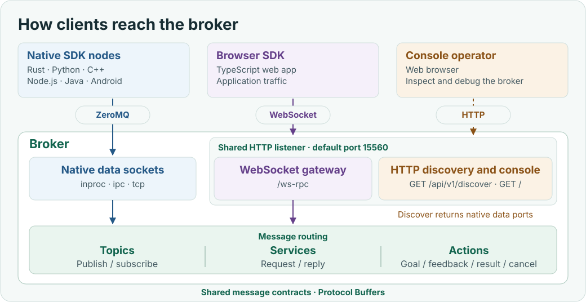
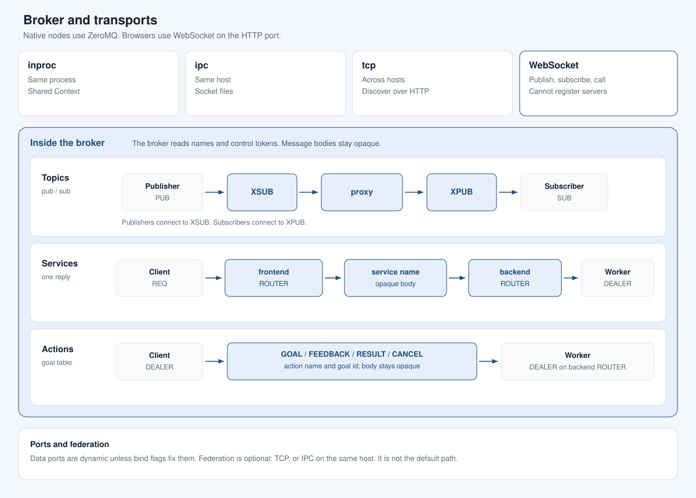
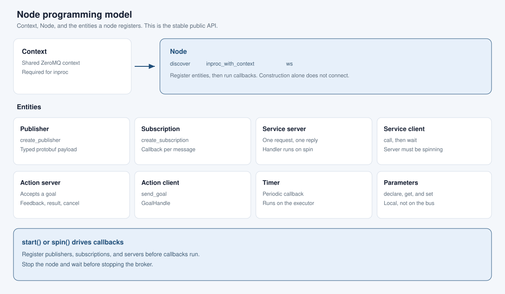

English | [中文](../zh/architecture.md)

# Architecture

Robot Bus is a standalone multi-language messaging framework with a ROS 2–style Node API. Its parts serve different purposes:

- **Core messaging:** Nodes use shared Protobuf contracts to publish topics, call services, and run actions through a broker. Native nodes use ZeroMQ and need neither ROS 2 nor a browser. See [deployment](deployment.md) for connection setup.
- **Browser SDK:** A web app can act as a [WebSocket client](typescript-api.md#browser-websocket-rpc) for application messages and calls.
- **Web console:** The broker can serve an [interface for inspecting and debugging the system](../../README.md#2-web-console). It is not needed for clients to exchange messages.
- **ROS 2 bridge:** An [optional integration](ros2-bridge.md) maps selected routes between Robot Bus and an existing ROS 2 graph. Neither Web feature requires ROS 2, and the bridge does not require a browser.

## System overview

*Language SDKs and the browser share one broker. Discover, the console, and WebSocket RPC share the HTTP port.*

## Broker and transports

*Native nodes use inproc, ipc, or tcp. Browsers call in over WebSocket and cannot register servers.*

## Node model

*A node registers entities, then start() or spin() drives callbacks. Constructing a Node does not connect.*

## Broker federation

*Federation is optional. A broker learns its peer from discover, then forwards topics, services, and actions. Clients stay on their own broker.*

## ROS 2 bridge

*Edge hosts stay on protobuf. An in-process bridge maps one direction onto a Humble or Jazzy graph, and that process is the only meeting point.*
