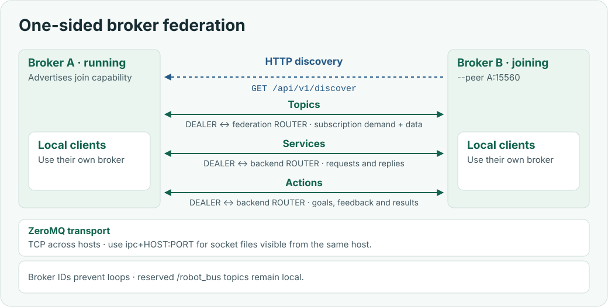
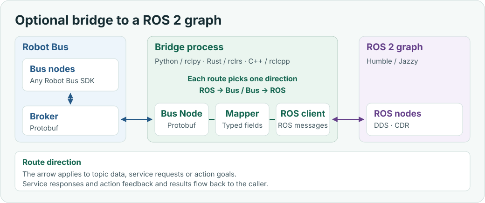

English | [中文](../zh/architecture.md)

# Architecture

Robot Bus gives applications a ROS 2–style Node API for topics, services, and actions. SDKs share Protobuf message definitions, and the broker routes payloads across languages. The [ROS 2 bridge](#ros-2-bridge) is an optional integration for connecting to an existing ROS 2 graph.

## System overview

- Native SDKs use ZeroMQ for application traffic. For TCP, `GET /api/v1/discover` supplies the data ports. Clients use the host they contacted unless the broker advertises a different host.
- The [TypeScript browser SDK](typescript-api.md#browser-websocket-rpc) uses `/ws-rpc` to publish and subscribe, call services, and send action goals. Service and action servers run on native ZeroMQ nodes.
- The [Web console](../../README.md#2-web-console) provides runtime inspection. Its UI at `/`, HTTP discovery, and WebSocket RPC share the broker’s HTTP listener, which defaults to port `15560`.

## Broker and transports

The broker can run inside an application or as a standalone process. Topic routing uses an XSUB/XPUB proxy. Service routing selects a worker by service name and correlates the reply. Action routing tracks each goal so feedback, results, and cancellation reach the appropriate endpoint. The broker routes by names and protocol metadata while keeping Protobuf payloads opaque. Use the [deployment guide](deployment.md) to choose a transport and configure ports.

Native subscriptions have independent KeepLast queues between receive and callback execution. Stateful publishers retain the current sample. Brokers carry replay requests and responses through the topic routing path. See [topic QoS and retention](rust-api.md#high-water-mark-hwm-and-qos).

## Node model

Constructing a `Node` alone leaves the connection unestablished. For readiness, explicitly discover the broker or use `wait_for_broker`. Register publishers, subscriptions, servers, and other entities, then drive callbacks with `spin()` or the SDK’s background `start()` where available. Within a single process, an inproc broker and its nodes share a ZeroMQ `Context`.

## Broker federation

With two current brokers, start A first and pass `--peer A:15560` when starting B. A advertises `federation: ["join"]` and `messageFedPort` in discovery. B uses the advertised endpoints to join A. That one configuration enables traffic in both directions while clients stay connected to their local brokers. Topic links exchange subscription demand, and the reserved `/robot_bus` topic namespace stays on each broker.

Use TCP across hosts or `--peer ipc+A:15560` when the two brokers can access the same host’s IPC socket files. A legacy peer without the `join` capability requires mutual peer configuration. See the [broker options](rust-api.md#broker-startup) for explicit endpoints and fixed IPC directories.

## Payload encoding

Protobuf is the default encoding in every SDK. It is not part of the wire protocol. The broker forwards the payload unchanged and does not parse it. A publisher that omits a message type, or uses the raw-bytes API, can send any encoding. Subscribers on that topic must agree on the encoding themselves.

Typed publishers register a type name with the broker console. The first name is kept. A later registration with a different name does not replace it and does not reject the connection. The console records the conflicting name, emits one `WARN` event for that pair, and returns the names as `conflictTypes` on the topics API. `rbus topic` prints them. The check runs only when the console API is enabled. Android lite messages have no descriptors; generated classes are registered by stripping the `org.indunet.robot.bus.` prefix from the Java class name, which is the protobuf full name. Custom lite types outside that package are not registered.

## ROS 2 bridge

A bridge runs in a Python, Rust, or C++ application and maps selected routes between Protobuf on Robot Bus and ROS 2 types on a Humble or Jazzy graph. Each route chooses one direction for topic data, service requests, or action goals. Service responses and action feedback and results flow back to the caller. See the [ROS 2 bridge guide](ros2-bridge.md) for typed mappers and examples.
