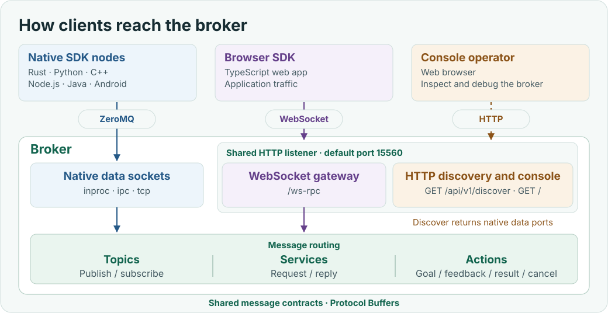
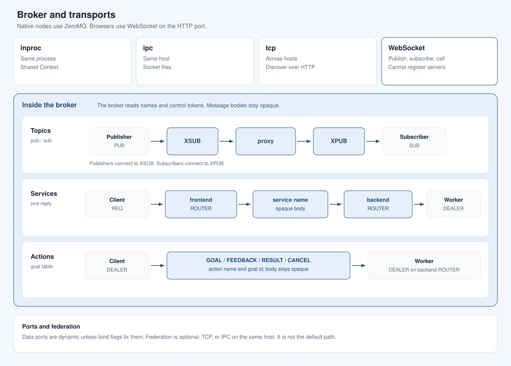
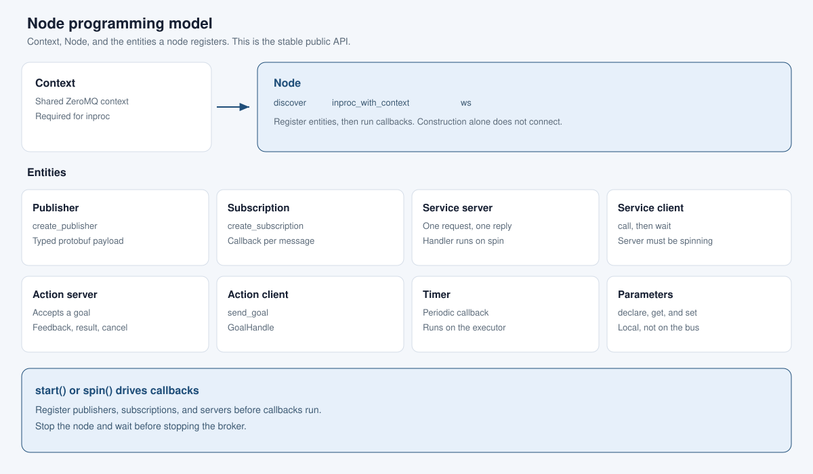
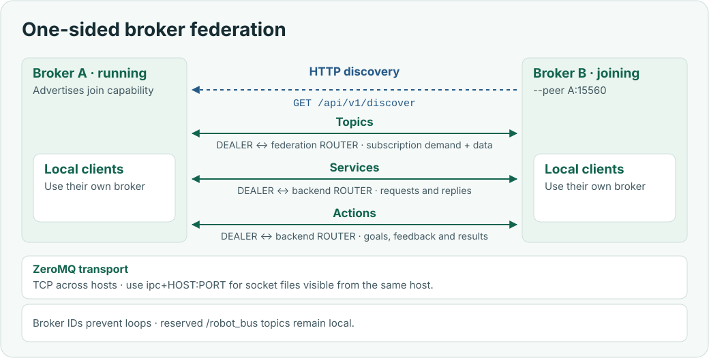
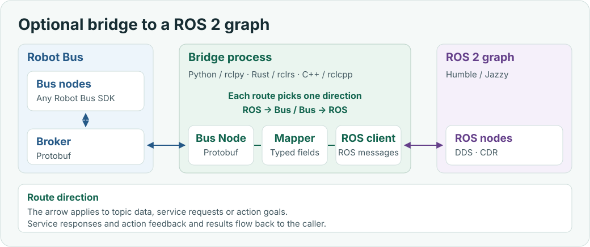

[English](../en/architecture.md) | 中文

# 架构

Robot Bus 是独立运行的多语言消息框架，采用 ROS 2 风格的节点模型。下面四部分各有用途：

- **核心通信：** 节点通过 broker 发布话题、调用服务和运行 Action，共用 Protobuf 消息契约。原生节点走 ZeroMQ，不需要 ROS 2 或浏览器。连接配置见[部署与排障](deployment.md)。
- **浏览器 SDK：** 让网页通过 [WebSocket](typescript-api.md#浏览器websocket-rpc)成为业务客户端，参与消息收发和调用。
- **Web 控制台：** broker 可提供[观测和调试界面](../../README-zh.md#2-web控制台)。客户端之间收发消息不需要控制台。
- **ROS 2 桥：** [可选集成](ros2-bridge.md)，把选定的路由映射到已有的 ROS 2 通信图。浏览器 SDK 和控制台都不需要 ROS 2，使用桥也不需要浏览器。

## 系统概览

*各语言的 SDK 和浏览器共用一个 broker。HTTP 发现接口、控制台和 WebSocket RPC 共用同一个 HTTP 端口。*

## Broker 与传输方式

*原生节点使用 `inproc`、`ipc` 或 `tcp`。浏览器可以通过 WebSocket 发起调用，但无法注册服务端。*

## 节点模型

*节点先注册发布者、订阅者等实体，再通过 `start()` 或 `spin()` 驱动回调。创建 `Node` 时不会建立连接。*

## Broker 联邦

*按需启用 broker 联邦。启用后，broker 通过发现接口获取对端信息，再转发话题、服务和 Action。客户端继续连接各自的 broker。*

## ROS 2 桥接

*边缘主机继续使用 Protobuf。进程内的桥连接 Robot Bus 与 ROS 2 Humble 或 Jazzy，每条路由单独配置映射方向。两个系统只在桥接进程内交接。*
