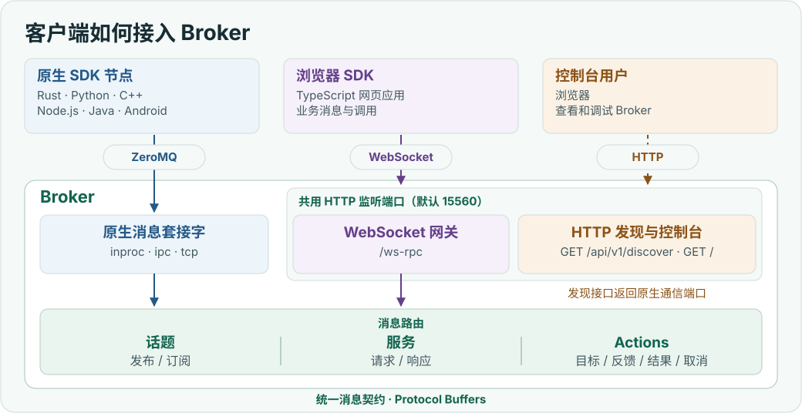
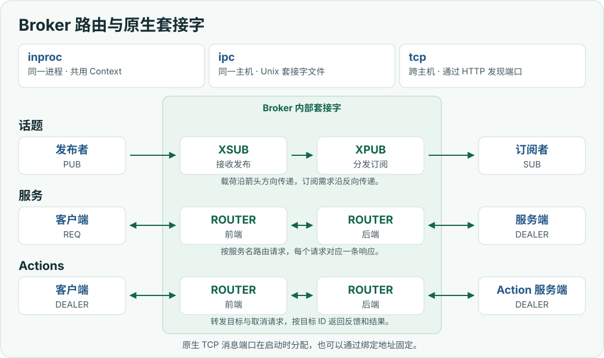
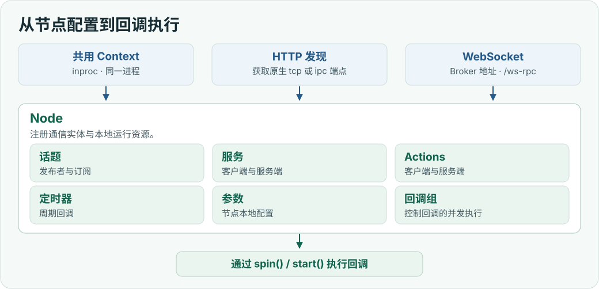
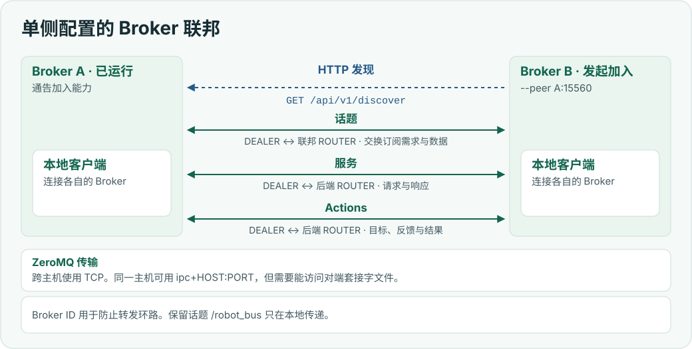
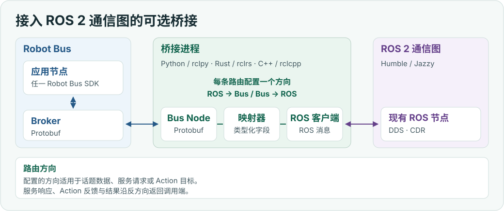

[English](../en/architecture.md) | 中文

# 架构

Robot Bus 通过 ROS 2 风格的 Node API 提供话题、服务和 Action。各语言 SDK 共用 Protobuf 消息定义，Broker 负责跨语言转发载荷。如需接入已有的 ROS 2 通信图，可选用 [ROS 2 桥接](#ros-2-桥接)。

## 系统概览

- 原生 SDK 通过 ZeroMQ 收发业务消息。使用 TCP 时，节点通过 `GET /api/v1/discover` 获取通信端口，默认沿用访问发现接口时使用的主机地址，也可由 Broker 指定通信地址。
- [TypeScript 浏览器 SDK](typescript-api.md#浏览器websocket-rpc) 通过 `/ws-rpc` 发布和订阅话题、调用服务、发送 Action 目标。服务和 Action 的服务端运行在原生 ZeroMQ 节点上。
- [Web 控制台](../../README-zh.md#2-web控制台)用于查看运行状态。控制台页面 `/`、HTTP 发现接口和 WebSocket RPC 共用 Broker 的 HTTP 监听端口，默认为 `15560`。

## Broker 与传输方式

Broker 可以在应用内启动，也可以作为独立进程运行。话题用 XSUB/XPUB 代理分发，服务按服务名分派请求并关联响应，Action 按目标跟踪反馈、结果和取消请求。Broker 根据名称和协议元数据路由，Protobuf 载荷原样传递。传输选择和端口配置见[部署与排障](deployment.md)。

## 节点模型

仅创建 `Node` 时还未建立连接。可以显式发现 Broker，或用 `wait_for_broker` 等待就绪。注册发布者、订阅、服务端等实体后，用 `spin()` 或 SDK 支持的后台 `start()` 执行回调。同一进程内走 inproc 时，Broker 和节点共用 ZeroMQ `Context`。

## Broker 联邦

两个 Broker 都使用当前版本时，先启动 A，再在启动 B 时传入 `--peer A:15560`。A 在发现响应中返回 `federation: ["join"]` 和 `messageFedPort`，B 使用公布的端点加入 A。只需在 B 上配置，业务流量就可以双向转发，客户端仍连接各自的 Broker。话题联邦会交换订阅需求，保留的 `/robot_bus` 话题仍留在本地。

跨主机使用 TCP。同一主机上的两个 Broker 如果能访问对端的 IPC 套接字文件，可以使用 `--peer ipc+A:15560`。与缺少 `join` 能力的旧版 Broker 互通时，需要在两侧配置对端。显式端点和固定 IPC 目录见 [Broker 启动选项](rust-api.md#broker启动)。

## ROS 2 桥接

桥接可运行在 Python、Rust 或 C++ 应用中，在 Robot Bus 的 Protobuf 消息与 Humble 或 Jazzy 通信图的 ROS 2 类型之间转换。每条路由都要为话题数据、服务请求或 Action 目标选择一个方向。服务响应以及 Action 的反馈和结果沿反方向返回调用端。映射器和示例见 [ROS 2 桥接指南](ros2-bridge.md)。
